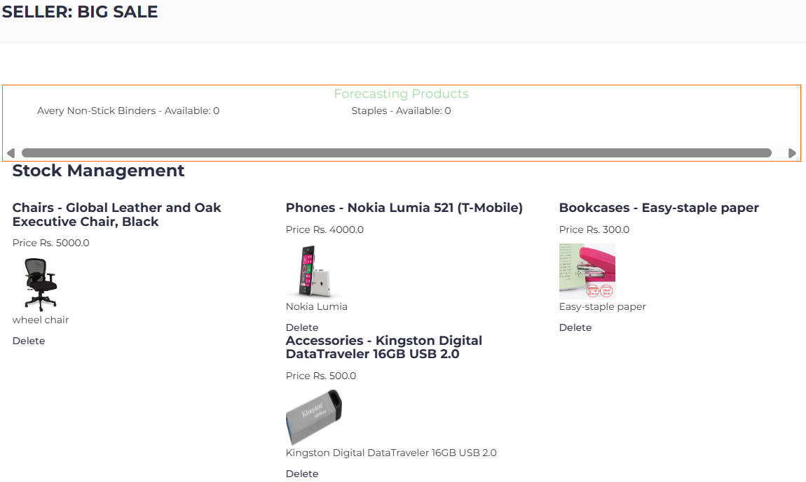
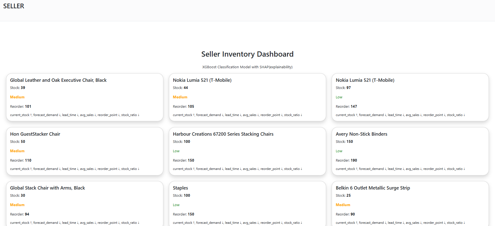
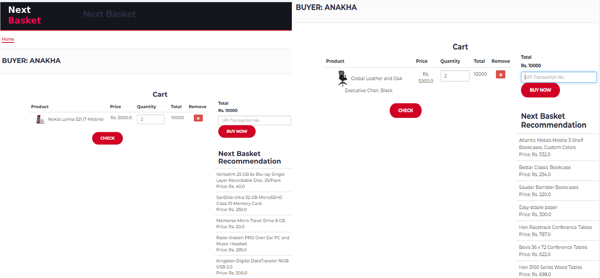

# Predictive Analytics for E-Commerce: Demand Forecasting & Customer Personalization

An integrated e-commerce analytics application that combines product recommendation, demand forecasting, and inventory risk prediction to support data-driven business decisions.

## Overview

E-commerce businesses face challenges in understanding customer purchasing behaviour, predicting future demand, and maintaining optimal inventory levels.

This project explores how predictive analytics and machine learning can help address these challenges through an integrated e-commerce application.

The system focuses on three key areas:

- **Product Recommendations:** Suggesting relevant products based on customer purchasing behaviour.
- **Demand Forecasting:** Predicting future sales demand using historical sales patterns.
- **Inventory Risk Prediction:** Identifying products that may face stock shortages to support proactive inventory management.

## Business Problem

Traditional e-commerce systems may rely on generic recommendations and reactive inventory management, resulting in:

- Irrelevant product suggestions.
- Poor demand estimation.
- Overstocking and stock shortages.
- Inefficient inventory planning.
- Missed opportunities for customer engagement.

The project explores a predictive approach to improving these processes.

## Project Objectives

- Develop an integrated analytics-driven e-commerce application.
- Generate product recommendations using customer purchase patterns.
- Forecast future demand using time-series analysis.
- Identify potential inventory risks using machine learning.
- Provide analytical insights to support seller decision-making.

## System Architecture

The application combines a web-based interface, backend services, database management, and predictive analytics modules.

### 1. Product Recommendation System

Developed a product recommendation module that analyses purchasing patterns and product popularity to generate relevant product suggestions.

**Approach:**
- Analyse product purchase and rating patterns.
- Identify popular products.
- Generate recommendations while considering previously purchased products.

### 2. Demand Forecasting

Implemented a time-series forecasting module using **Prophet** to analyse historical sales data and generate future demand predictions.

**Key capabilities:**
- Historical sales analysis.
- Trend and seasonality analysis.
- Future sales forecasting.
- 30-day demand prediction.

### 3. Inventory Risk Prediction

Developed an inventory-risk analysis module using **XGBoost** to classify products based on potential stock depletion.

**Key capabilities:**
- Analyse inventory and sales-related features.
- Identify products requiring inventory attention.
- Generate stock-risk classifications.
- Use SHAP for model interpretability.

## Technology Stack

| Category | Technologies |
|---|---|
| Programming | Python |
| Backend | Flask |
| Database | MySQL |
| Machine Learning | XGBoost, Scikit-learn |
| Time-Series Forecasting | Prophet |
| Explainable AI | SHAP |
| Data Processing | Pandas, NumPy |
| Data Visualization | Matplotlib, Seaborn |
| Frontend | HTML, CSS, Bootstrap |
| Development Environment | Jupyter Notebook, WAMP Server |

## Repository Structure

```text
├── main.py
├── ml_model.py
├── recommendation_model.py
├── demand_forecasting.py
├── stock_risk_model.py
├── sales_data.csv
├── inventory_risk_dashboard.png
├── sales_forecast.png
├── recommendation_system.png
├── project_ppt.pdf
├── README.md
└── LICENSE
```

## Results & Visualizations

### Sales Demand Forecasting

Visual representation of predicted sales trends and future demand.



### Inventory Risk Dashboard

Visualization of inventory-related risk and stock monitoring.



### Product Recommendation System

Illustration of the product recommendation module.



## Key Business Applications

- Support inventory planning through demand forecasting.
- Identify products requiring timely stock replenishment.
- Improve product discovery through personalized recommendations.
- Support data-driven inventory and sales decisions.

## Limitations & Future Enhancements

Potential improvements to the project include:

- Implementing a transformer-based sequential recommendation model such as BERT4Rec.
- Evaluating forecasting performance using MAE, RMSE and sMAPE.
- Improving stock-out prediction through time-aware validation and leakage-free feature engineering.
- Extending inventory optimization to multiple warehouses.
- Integrating customer sentiment analysis.
- Developing an AI-powered business assistant using Large Language Models (LLMs) and Retrieval-Augmented Generation (RAG).

## Project Information

**Project Type:** MSc Applied Data Science – Final Year Project

**Focus Areas:** Predictive Analytics, Machine Learning, Time-Series Forecasting, Recommendation Systems and E-Commerce Analytics.

**Author:** Anakha N

## License

This project is licensed under the MIT License.
